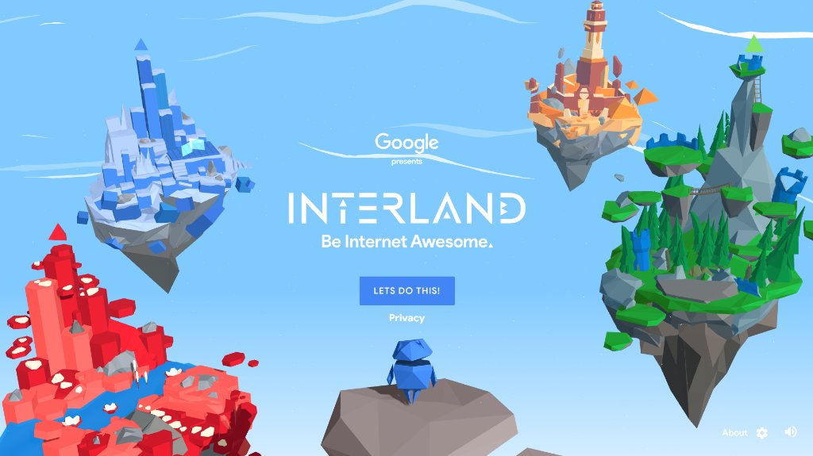
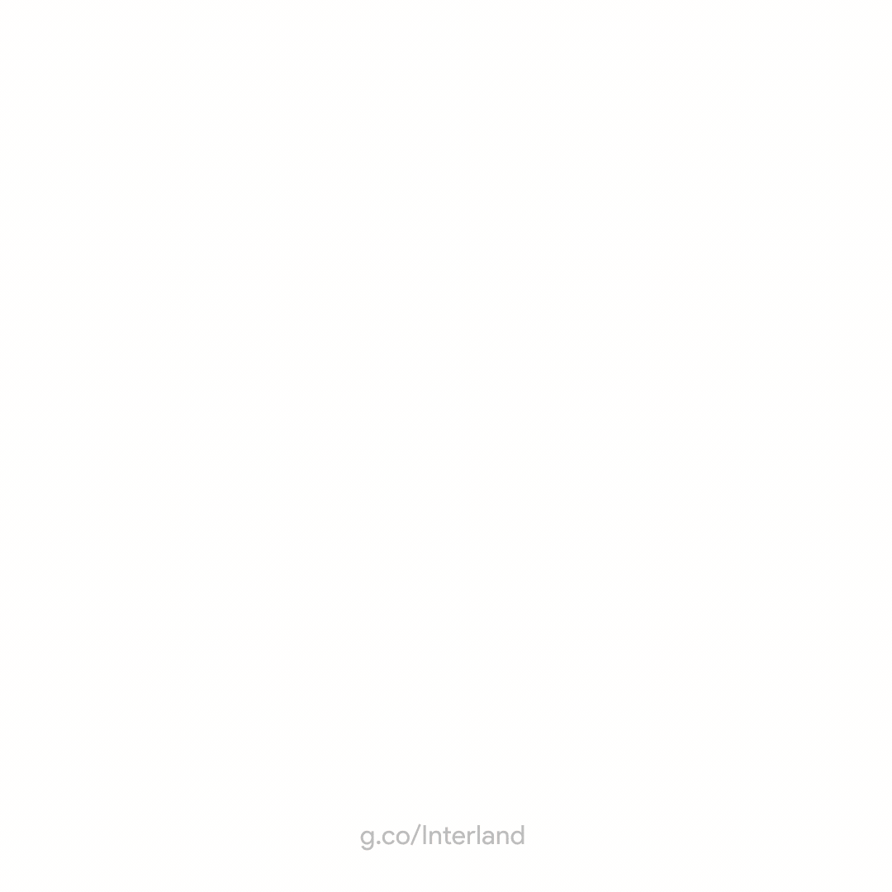
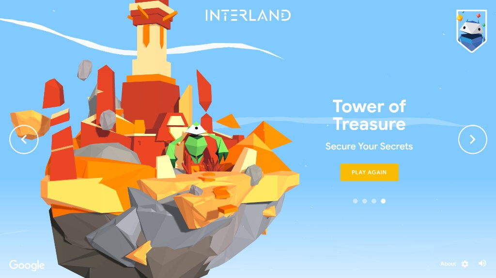
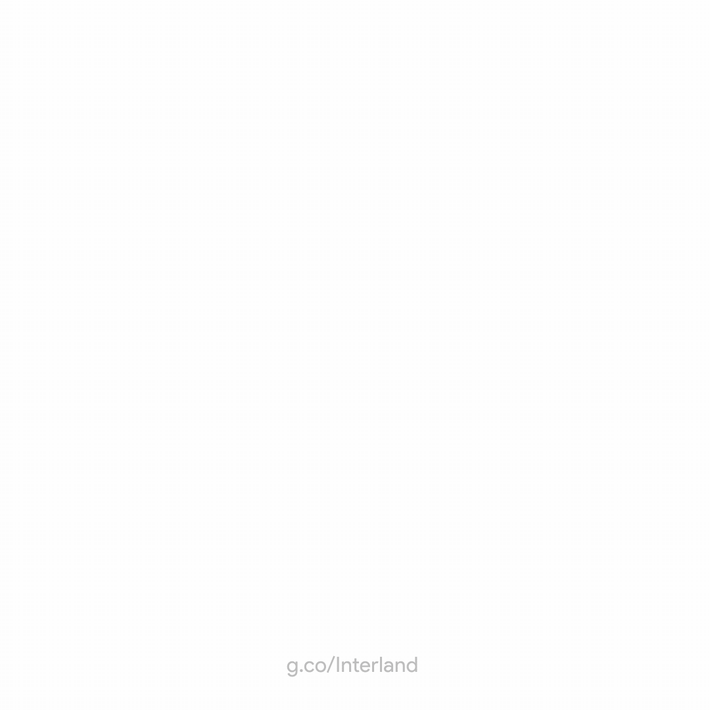
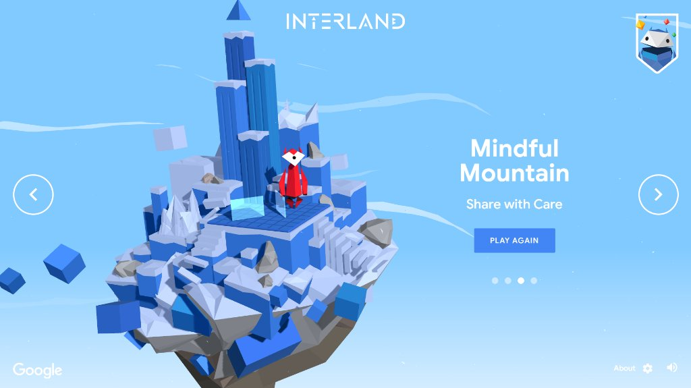
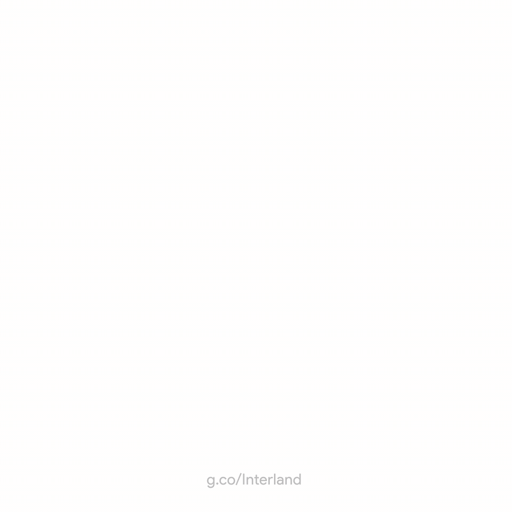
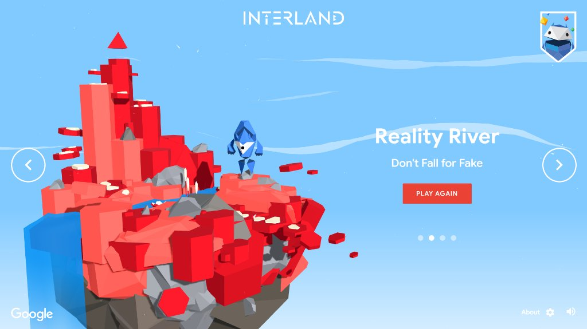
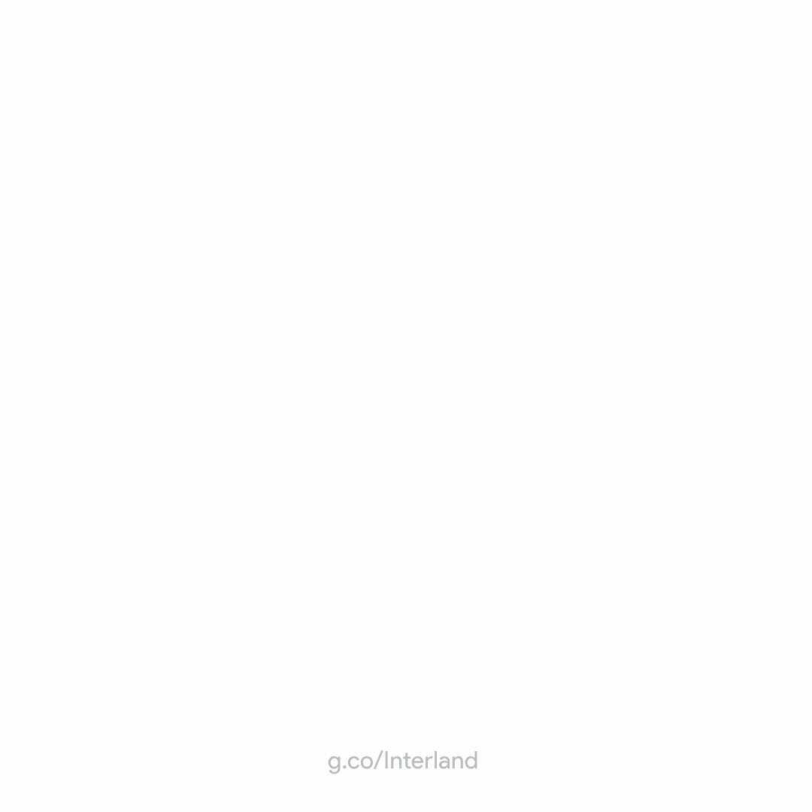
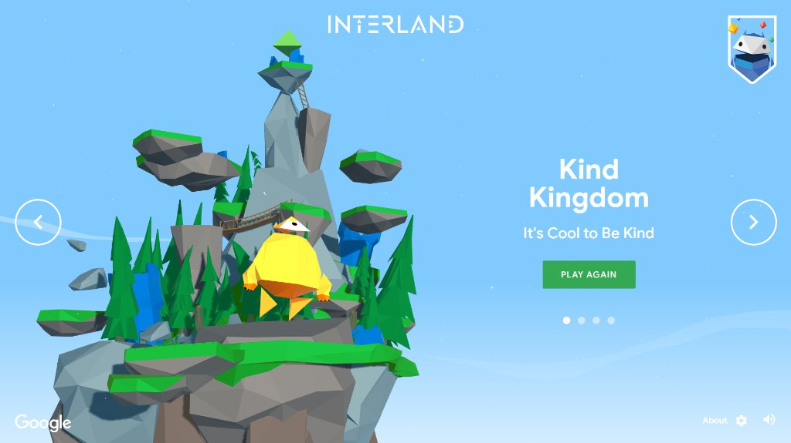
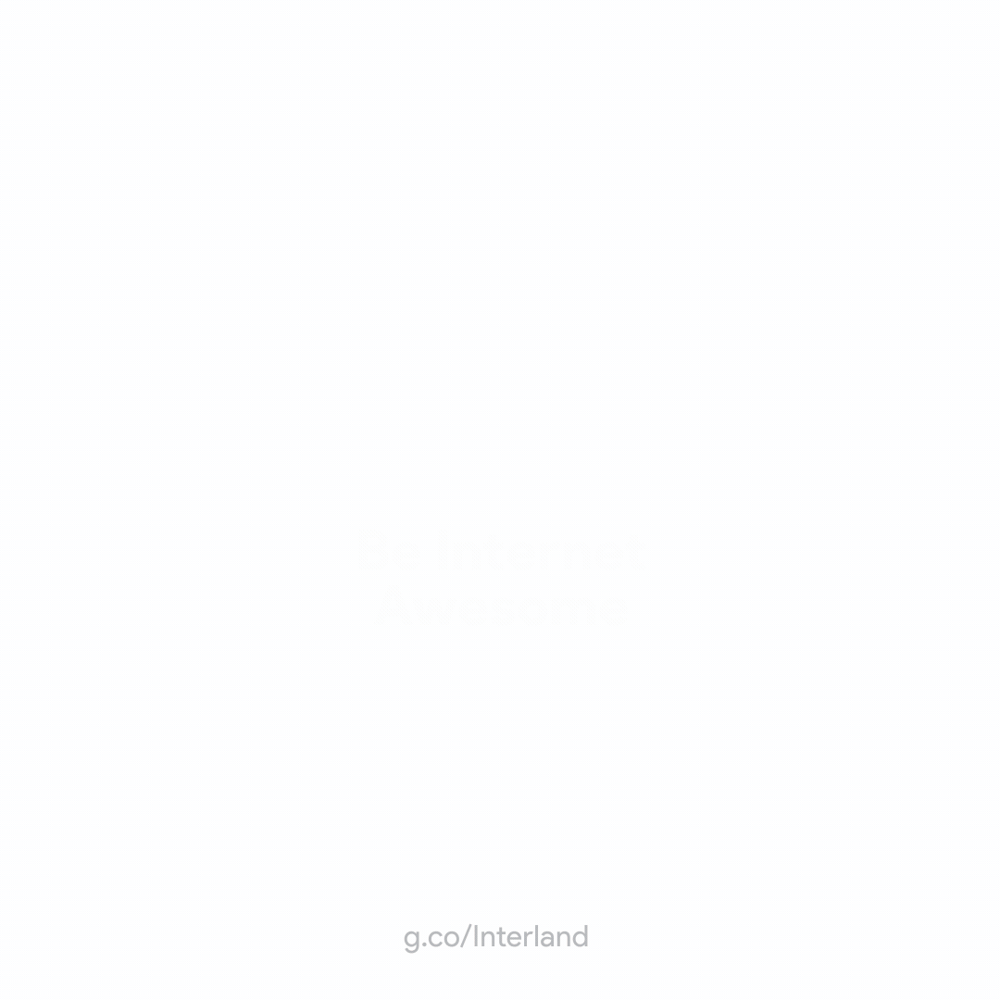

# 🌐 Google Interland - Khám phá thế giới an toàn số 🛡️

> *"Để tận dụng tối đa lợi ích của Internet, chúng ta cần chuẩn bị sẵn sàng để đưa ra những quyết định thông minh khi tham gia thế giới trực tuyến."*

Chào mừng bạn đến với góc lưu trữ trải nghiệm **Google Interland** của mình! Thư mục này ghi lại hành trình chinh phục 4 vùng đất trong trò chơi giáo dục an toàn mạng nổi tiếng của Google, cùng bộ sưu tập hình ảnh, huy hiệu hoạt họa và các chứng nhận chính thức.

<div align="center">
  
</div>

<br/>

<div align="center">
  
  
  
</div>

---

## 🎮 1. Google Interland là gì?

**[Interland](https://beinternetawesome.withgoogle.com/vi_vn/interland)** là một tựa game phiêu lưu 3D trực tuyến đồ họa Low-poly tuyệt đẹp được phát triển bởi **Google**, nằm trong khuôn khổ chương trình giáo dục toàn cầu **"Be Internet Awesome"** *(tại Việt Nam được triển khai dưới tên gọi "Em an toàn hơn cùng Google")*.

Trong trò chơi, người chơi sẽ hóa thân thành các cư dân mạng dũng cảm mang tên **Internaut**, chu du qua 4 hòn đảo kỳ thú lơ lửng giữa không gian. Tại mỗi vùng đất, người chơi sẽ đối mặt với những thử thách thực tế thường gặp trên không gian mạng: tin tặc, kẻ câu trộm dữ liệu, kẻ phát tán chuyện riêng tư hay kẻ bắt nạt trực tuyến.

👉 **Trải nghiệm trực tiếp:** [Chơi Google Interland tại đây](https://beinternetawesome.withgoogle.com/vi_vn/interland)

---

## 🗺️ 2. Khám phá 4 vùng đất & Ý nghĩa giáo dục

```
                          ┌──────────────────────────┐
                          │    THẾ GIỚI INTERLAND    │
                          └───────────┬──────────────┘
         ┌────────────────────┬───────┴──────────┬──────────────────────┐
         ▼                    ▼                  ▼                      ▼
  🏰 THÁP KHO BÁU     🏔️ ĐỒI THẬN TRỌNG    🌊 SÔNG THỰC HƯ    👑 VƯƠNG QUỐC TỬ TẾ
(Be Internet Strong)  (Be Internet Smart)  (Be Internet Alert)   (Be Internet Kind)
```

---

### 🏰 1. Tháp kho báu (Tower of Treasure)
> **Khẩu hiệu:** *"Bảo vệ bí mật của bạn" (Be Internet Strong)*

<div align="center">
  <table>
    <tr>
      <td width="30%" align="center">
        <br/>
        <sub><b>Huy hiệu Tháp Kho Báu</b></sub>
      </td>
      <td width="70%">
        
      </td>
    </tr>
  </table>
</div>

* **Đối thủ chính:** Kẻ xâm nhập / Tin tặc *(Hacker)*.
* **Thử thách gameplay:** Điều khiển Internaut chạy nhanh thu thập các mẩu thông tin nhận dạng cá nhân quan trọng (mật khẩu, địa chỉ, email...) và nhanh chóng cất giữ chúng vào kho báu kiên cố trước khi bị kẻ xâm nhập bắt kịp.
* **Ý nghĩa & Bài học cốt lõi:**
  * **Tạo mật khẩu mạnh:** Kết hợp chữ hoa, chữ thường, số, ký tự đặc biệt; tuyệt đối không dùng thông tin cá nhân dễ đoán như ngày sinh hay họ tên.
  * **Bảo vệ danh tính cá nhân:** Giữ kín thông tin nhạy cảm (số CCCD, tài khoản ngân hàng, thông tin gia đình).
  * **An toàn thiết bị:** Luôn cài đặt khóa màn hình và bảo mật 2 lớp (2FA) cho các tài khoản quan trọng.

---

### 🏔️ 2. Đồi thận trọng (Mindful Mountain)
> **Khẩu hiệu:** *"Chia sẻ cẩn thận" (Be Internet Smart)*

<div align="center">
  <table>
    <tr>
      <td width="30%" align="center">
        <br/>
        <sub><b>Huy hiệu Đồi Thận Trọng</b></sub>
      </td>
      <td width="70%">
        
      </td>
    </tr>
  </table>
</div>

* **Đối thủ chính:** Kẻ buôn chuyện / Chia sẻ quá đà *(Oversharer)*.
* **Thử thách gameplay:** Sử dụng các tấm gương khúc xạ góc độ để truyền luồng thông tin chỉ đến đúng đối tượng mong muốn, tuyệt đối không để thông tin phản chiếu vào khu vực của kẻ chia sẻ bừa bãi.
* **Ý nghĩa & Bài học cốt lõi:**
  * **Dấu chân kỹ thuật số (Digital Footprint):** Một bài viết, bức ảnh hay bình luận một khi đã đăng tải lên Internet thì gần như sẽ tồn tại vĩnh viễn và có thể bị lan truyền rộng rãi.
  * **Cân nhắc trước khi đăng:** Luôn tự hỏi bản thân: *"Thông tin này có ảnh hưởng tiêu cực đến mình hoặc người khác trong tương lai không?"*.
  * **Tôn trọng quyền riêng tư người khác:** Không đăng tải hình ảnh hay thông tin bí mật của bạn bè khi chưa được sự đồng ý.

---

### 🌊 3. Sông thực hư (Reality River)
> **Khẩu hiệu:** *"Đừng cắn câu" (Be Internet Alert)*

<div align="center">
  <table>
    <tr>
      <td width="30%" align="center">
        <br/>
        <sub><b>Huy hiệu Sông Thực Hư</b></sub>
      </td>
      <td width="70%">
        
      </td>
    </tr>
  </table>
</div>

* **Đối thủ chính:** Kẻ câu trộm / Giả mạo *(Phisher)*.
* **Thử thách gameplay:** Lội qua dòng sông hiểm trở với đầy cá mập rình rập bằng cách trả lời nhanh và chính xác các câu hỏi tình huống để nhận biết các thủ đoạn lừa đảo tinh vi.
* **Ý nghĩa & Bài học cốt lõi:**
  * **Tư duy phản biện:** Không vội vàng tin vào các thông tin giật gân, giải thưởng "miễn phí" quá hấp dẫn hoặc những tin đồn chưa được xác thực.
  * **Nhận diện tấn công giả mạo (Phishing):** Nhận biết dấu hiệu lừa đảo qua đường link URL sai lệch, email giả mạo ngân hàng/tổ chức, hoặc các tệp đính kèm đáng ngờ.
  * **Kiểm chứng thông tin:** Luôn kiểm tra lại thông tin từ các kênh chính thống trước khi thực hiện giao dịch hay chia sẻ.

---

### 👑 4. Vương quốc tử tế (Kind Kingdom)
> **Khẩu hiệu:** *"Tử tế là tuyệt nhất" (Be Internet Kind)*

<div align="center">
  <table>
    <tr>
      <td width="30%" align="center">
        <br/>
        <sub><b>Huy hiệu Vương Quốc Tử Tế</b></sub>
      </td>
      <td width="70%">
        
      </td>
    </tr>
  </table>
</div>

* **Đối thủ chính:** Kẻ gây rối / Bắt nạt trên mạng *(Troublemaker / Cyberbully)*.
* **Thử thách gameplay:** Chạy khắp vương quốc phát những trái tim ấm áp để lan tỏa năng lượng tích cực, an ủi những bạn Internaut đang buồn và dựng tường năng lượng ngăn chặn kẻ bắt nạt.
* **Ý nghĩa & Bài học cốt lõi:**
  * **Văn hóa ứng xử văn minh:** Giữ thái độ lịch sự, tích cực và tôn trọng người khác trong các cuộc trò chuyện trực tuyến.
  * **Chống bạo lực mạng:** Trở thành một người bảo vệ (*Upstander*) dám lên tiếng giúp đỡ nạn nhân, không đồng lõa hay đứng nhìn kẻ bắt nạt.
  * **Biết cách tự vệ:** Thành thạo các tính năng Chặn (*Block*) và Báo cáo (*Report*) khi gặp phải các hành vi quấy rối, độc hại.

---

## 🎁 3. Gói thành tựu từ Google

<div align="center">
  <br/>
  <b>Huy Hiệu Toàn Năng Siêu Cấp - "Be Internet Awesome"</b><br/>
  <sub><i>(Chứng nhận danh dự cao nhất dành cho cư dân mạng xuất sắc)</i></sub>
</div>

<br/>

* 🌟 **Chứng nhận tổng thể (Certificate of Awesomeness):** Bằng khen danh dự chính thức ghi nhận người chơi đã nắm vững đầy đủ 4 phẩm chất an toàn số của Google.
* 🎖️ **Bộ 5 Huy hiệu Động (Animated GIFs):** 4 huy hiệu tháp đại diện cho 4 vùng đất và 1 huy hiệu toàn năng xoay vòng rực rỡ.

---

## 🏆 4. Bảng Tổng Hợp Chứng Nhận Đã Đạt Được

Dưới đây là các chứng nhận chính thức ghi nhận quá trình hoàn thành của mình:

| STT | Danh Mục | Thông Điệp Vinh Danh | Tệp Chứng Nhận |
| :---: | :---| :---| :---: |
| 🌟 | **Toàn Bộ Thế Giới Interland** | **Chứng nhận Tổng Thể (Certificate of Awesomeness)** | [📜 Xem Chứng Nhận Tổng Thể](./Google_Interland_Jhanh_Certificate_of_Awesomeness.pdf) |
| 1 | 🏰 **Tháp Kho Báu** | *Bạn thật mạnh mẽ* | [📜 Xem Chứng Nhận](./Google_Interland_Jhanh_Chứng%20nhận%20_Bạn%20thật%20mạnh%20mẽ_.pdf) |
| 2 | 🏔️ **Đồi Thận Trọng** | *Bạn thật thông minh* | [📜 Xem Chứng Nhận](./Google_Interland_Jhanh_Chứng%20nhận%20_Bạn%20thật%20thông%20minh_.pdf) |
| 3 | 🌊 **Sông Thực Hư** | *Bạn thật tỉnh táo* | [📜 Xem Chứng Nhận](./Google_Interland_Jhanh_Chứng%20nhận%20_Bạn%20thật%20tỉnh%20táo_.pdf) |
| 4 | 👑 **Vương Quốc Tử Tế** | *Bạn thật tử tế* | [📜 Xem Chứng Nhận](./Google_Interland_Jhanh_Chứng%20nhận%20_Bạn%20thật%20tử%20tế_.pdf) |

---

<div align="center">
  <sub>✨ <i>"An toàn trên mạng không chỉ là việc bảo vệ bản thân, mà còn là chung tay xây dựng một thế giới trực tuyến văn minh, tích cực và lành mạnh cho tất cả mọi người."</i> ✨</sub>
</div>
